# Startseite: selbst gehostete Speed-Dial-Startseite

<p align="center">
  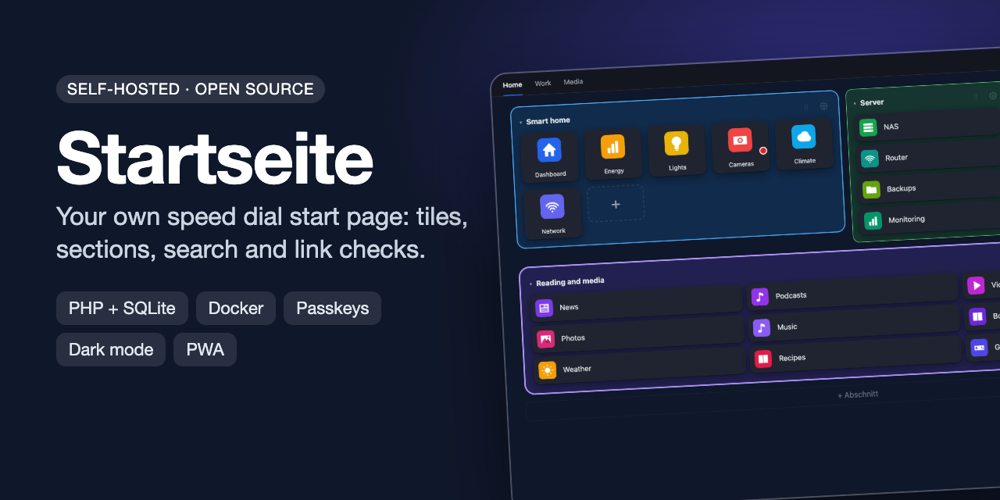
</p>

[](https://github.com/sphings79/startseite/actions/workflows/ci.yml)
[](https://github.com/sphings79/startseite/actions/workflows/docker.yml)
[](LICENSE)


[](https://buymeacoffee.com/sphings)

[English](README.md) | **Deutsch**

**Startseite** ist eine selbst gehostete **Speed-Dial-Startseite und Lesezeichen-Übersicht** für die Startseite oder den neuen Tab deines Browsers.
Lesezeichen sind Kacheln mit automatischen Logos oder Screenshots, sortiert in Tabs und **Abschnitte**, mit einem Tastendruck durchsuchbar
und im Hintergrund auf tote Links geprüft. Ein Benutzer, eine SQLite-Datei, kein Framework, keine Composer-Pakete.

> Die Oberfläche ist derzeit **nur auf Deutsch**. README, Anleitungen und Code-Kommentare gibt es auf Deutsch und Englisch.

Wer die Browser-Erweiterung **Speed Dial 2** genutzt hat, kann deren Export importieren. Lesezeichen-Dateien aus Chrome, Edge, Firefox und Safari gehen ebenfalls.

## Screenshots

| Hell | Dunkel |
|---|---|
| 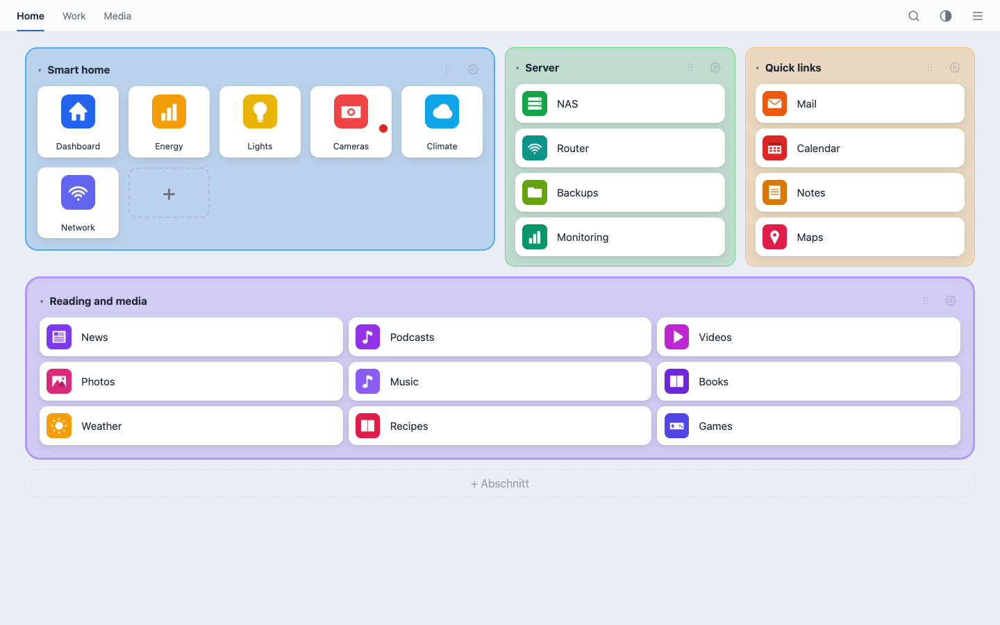 | 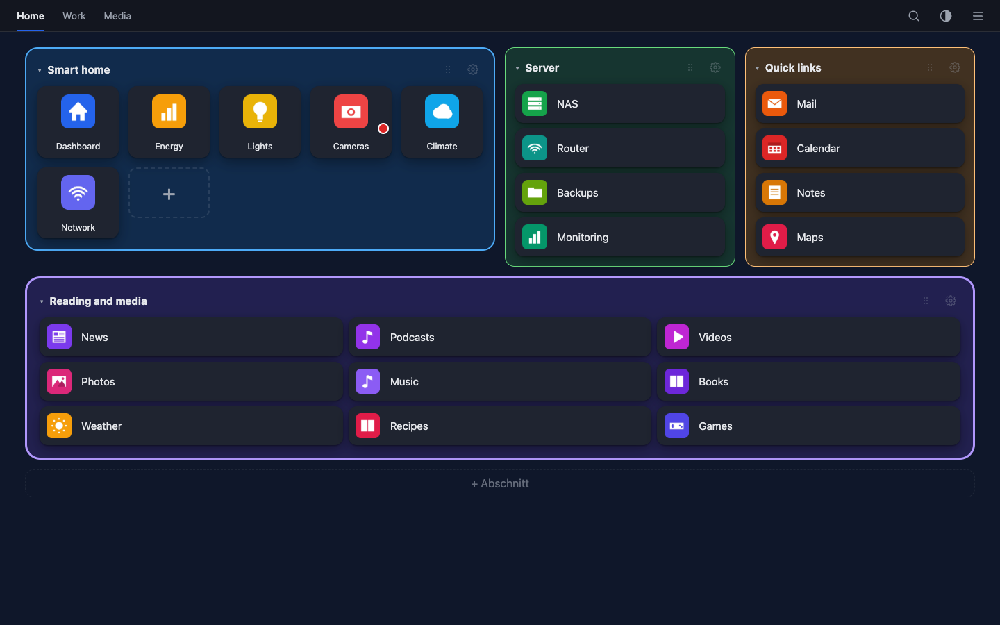 |

| Abschnitt bearbeiten | Link-Prüfung |
|---|---|
| 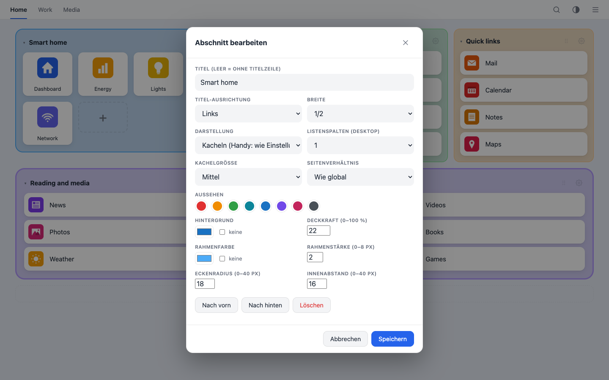 | 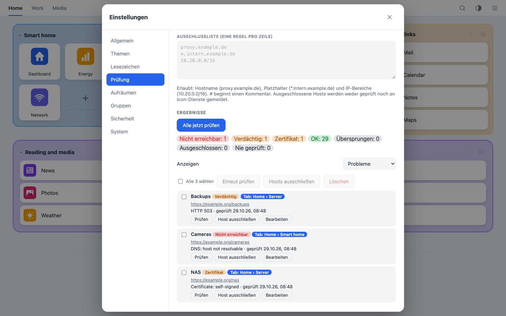 |

| Icon-Auswahl | Zuschneiden |
|---|---|
| 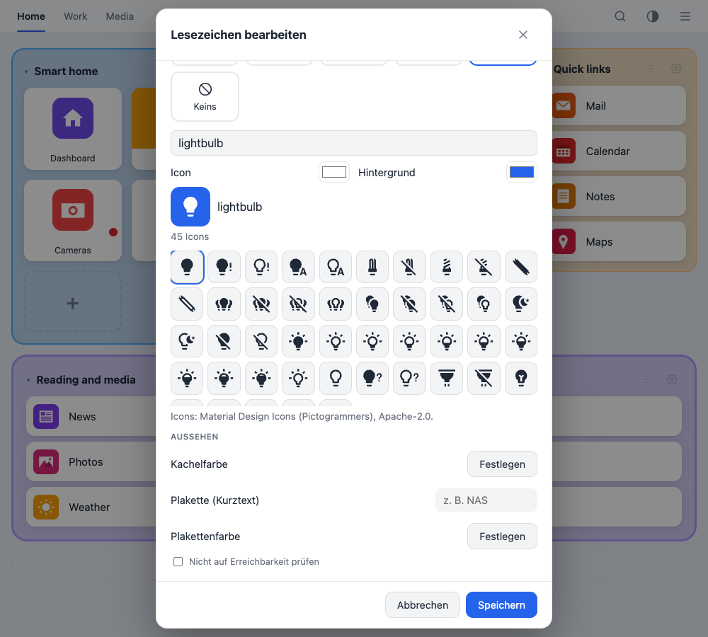 | 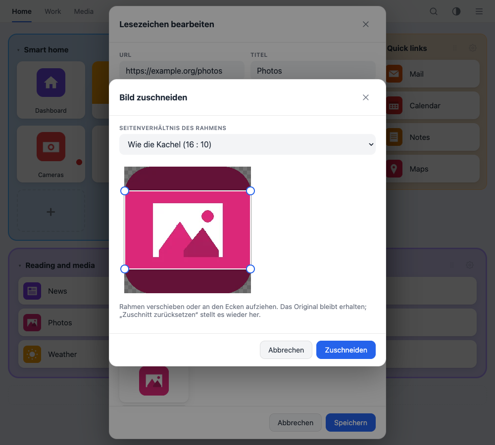 |

| Handy: Abschnitte | Handy: Liste | Handy: Menü | Passkey-Anmeldung |
|---|---|---|---|
| 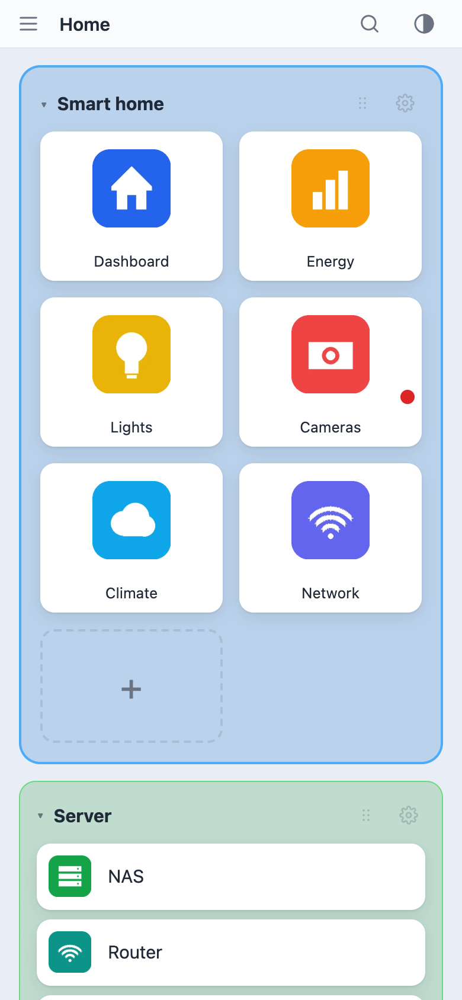 | 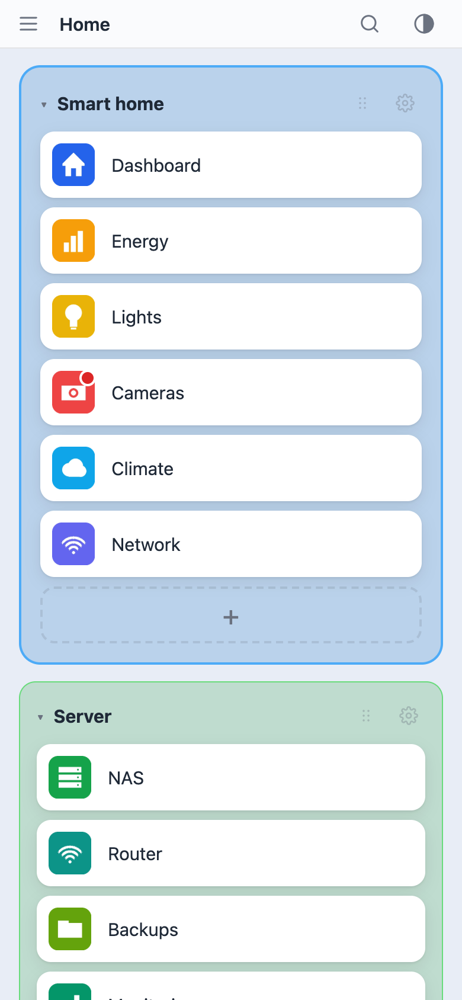 | 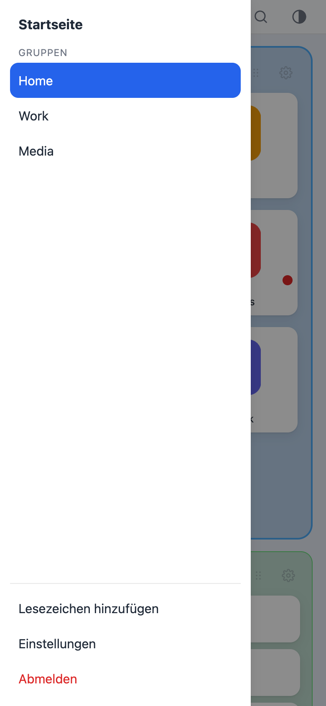 | 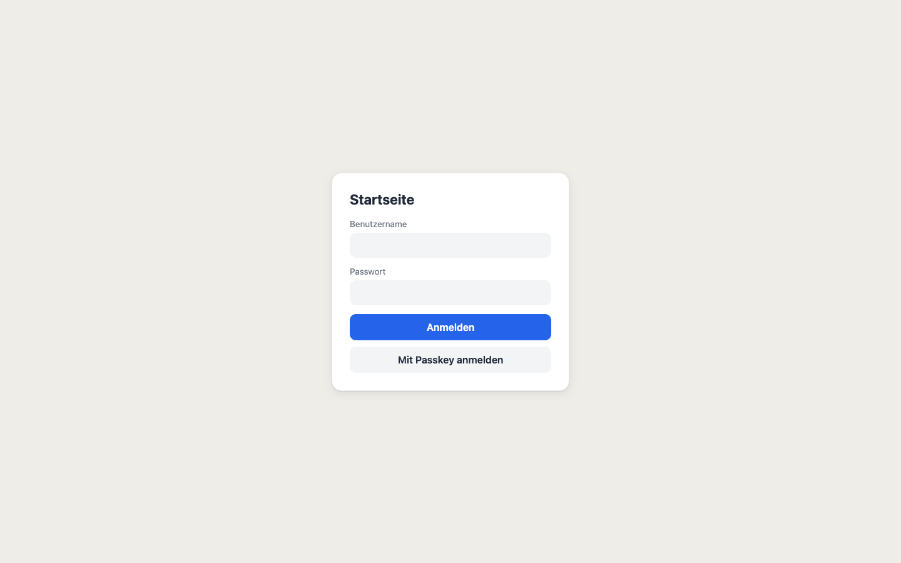 |

## Funktionen

- **Kacheln mit Vorschau:** Upload, Bild-URL (**SVG funktioniert**, von Chromium gezeichnet), das Logo der Seite selbst, [dashboard-icons](https://github.com/homarr-labs/dashboard-icons) (funktioniert per Name auch für LAN-Dienste), ein Headless-Chromium-Screenshot oder zuletzt ein Favicon. Logos und Screenshots werden immer vollständig gezeigt.
- **Icon-Auswahl:** Über 7.000 [Material Design Icons](https://pictogrammers.com/library/mdi/) per Namen suchen, Symbol- und Hintergrundfarbe wählen. Das Icon liegt als kleines SVG auf deinem Server, von außen wird nichts geladen.
- **Bilder zuschneiden:** Jedes hochgeladene, geladene oder gefundene Bild mit einem verschiebbaren Rahmen zuschneiden, frei oder im Seitenverhältnis der Kachel. Das Original bleibt erhalten, du kannst den Ausschnitt ändern oder zurücksetzen.
- **Tabs und Abschnitte:** Jeder Tab kann mehrere Abschnitte enthalten. Pro Abschnitt: Titel, Breite (1/4 bis voll), Kacheln oder Liste (1 bis 3 Spalten), Kachelgröße, Seitenverhältnis, Hintergrundfarbe mit Deckkraft, Rahmen, Eckenradius, Innenabstand. Kacheln lassen sich zwischen Abschnitten ziehen, Abschnitte am Griff, und sie sind einklappbar.
- **Schnelle Suche:** `/` drücken, tippen, Enter. Gesucht wird in Titel, URL, Tags, Notiz und der Meta-Beschreibung der Seite. `#tag` filtert nach Tag. Kürzel (`g`, `ddg`, `b`, `br`, `sp`, `e`, `q`) schicken die Eingabe an eine Web-Suchmaschine.
- **Link-Prüfung:** Ein Worker findet tote Links (DNS-Fehler, abgelehnte Verbindung, Zeitüberschreitung, 404/410, 5xx) und Zertifikatsprobleme, wiederholt an verschiedenen Tagen, bevor er einen Link für tot erklärt, und kennt Ausschlüsse für Hosts, Gruppen, einzelne Lesezeichen und ganze Netze.
- **Aufräum-Vorschläge:** nicht erreichbare, lange nicht besuchte, doppelte und bildlose Lesezeichen, jeweils mit eigener Liste sowie Bearbeiten und Löschen. Es wird nie automatisch gelöscht.
- **Import und Sicherung:** Import von Speed Dial 2, einer Startseite-Sicherung oder Lesezeichen-Dateien aus Chrome, Edge, Firefox und Safari. Automatische ZIP-Sicherungen mit Rotation, Download und Wiederherstellen in der Oberfläche.
- **Sichere Anmeldung:** Argon2id-Passwörter, optional **TOTP** mit Wiederherstellungscodes und **Passkeys** als Anmeldung ohne Passwort mit Button auf der Anmeldeseite (WebAuthn, Nutzerverifizierung Pflicht). Serverseitige Sitzungen, CSRF-Schutz, strenge CSP, Anmelde-Drosselung, SSRF-sicheres Abrufen.
- **Auf jedem Gerät bequem:** hell, dunkel und automatisch, Hintergrundfarbe oder -bild pro Design, Listenansicht fürs Handy, installierbar als **PWA**, Schnell-hinzufügen-Button und Teilen-Ziel.
- **Klein und unspektakulär mit Absicht:** PHP 8.2+, SQLite, Vanilla-JavaScript. Kein Framework, keine Composer-Pakete, kein Build-Schritt.
- **Vorbereitet für Widgets:** Abschnitte tragen schon einen Typ und ein Konfigurationsfeld, sodass später etwa eine Wetter-Karte ohne weitere Migration dazukommen kann.

## Schnellstart mit Docker

```bash
docker run -d --name startseite -p 8080:80 \
  -e STARTSEITE_USER=admin -e STARTSEITE_PASSWORD='ein-langes-passwort' \
  -v startseite-data:/data \
  ghcr.io/sphings79/startseite:latest
```

<http://localhost:8080> öffnen und anmelden. Der Benutzer wird nur beim ersten Start angelegt; die Passwort-Variable danach entfernen.
Außerhalb des Heimnetzes einen Reverse Proxy mit HTTPS davorsetzen und `STARTSEITE_TRUSTED_PROXIES` auf dessen Adresse stellen.
Passkeys brauchen HTTPS oder `localhost`.

Mit Docker Compose (baut das Image selbst, wenn du es nicht ziehst):

```bash
docker compose up -d --build
```

Vorher `STARTSEITE_USER` und `STARTSEITE_PASSWORD` (mindestens 12 Zeichen) in der `docker-compose.yml` setzen. Die Daten liegen im Volume `startseite-data`.

## Installation ohne Docker

Voraussetzungen: PHP 8.2+ mit `gd`, `pdo_sqlite`, `curl`, `mbstring`, `dom`, `zip`, dazu Apache mit `mod_rewrite` (oder nginx).

```bash
./deploy/build-package.sh            # erzeugt dist/startseite-<version>.tar.gz und .zip
tar xzf startseite-<version>.tar.gz && cd startseite-<version>
sudo ./deploy/install.sh --app-dir /srv/startseite --web-dir /var/www/html/startseite \
     --base-path /startseite --user www-data --worker --chromium
```

Derselbe Befehl aktualisiert eine bestehende Installation. `config/config.php`, Daten und Login bleiben erhalten.
Passwort ändern: `php bin/set_password.php admin`. Fertige Pakete hängen außerdem an jedem [GitHub-Release](../../releases).

nginx statt `.htaccess`:

```nginx
location /startseite/ { try_files $uri /startseite/index.php?$query_string; }
```

## Konfiguration

`config/config.php` (Vorlage: `config/config.sample.php`) oder `STARTSEITE_*`-Umgebungsvariablen, die Vorrang haben.

| Schlüssel | Bedeutung |
|---|---|
| `data_dir` | Datenbank, Bilder, Schlüssel; außerhalb des Webroots |
| `base_path` | `null` erkennt ihn aus der URL; nur setzen, wenn ein Proxy ein Präfix durchreicht |
| `trusted_proxies` | Reverse Proxies, deren `X-Forwarded-*` vertraut wird |
| `chromium_flags` | z. B. `--no-sandbox` im Container |
| `block_private_targets` | `true`: der Server holt keine Bilder oder Screenshots von LAN-Adressen (SSRF-Schutz) |

Zeigen die Lesezeichen auf interne Dienste (UniFi, Pi-hole, …) und der Server steht im selben Netz, `block_private_targets` auf `false` setzen
(`STARTSEITE_BLOCK_PRIVATE=0`). Ein Server im Internet erreicht LAN-Adressen ohnehin nicht; solche Kacheln bekommen eine Buchstaben-Kachel oder ein hochgeladenes Bild.

## Benutzung

### Abschnitte

Tab öffnen und **+ Abschnitt** unter den Kacheln nutzen, oder das Zahnrad an einem vorhandenen Abschnitt. Neue Tabs und bestehende Installationen starten mit einem Abschnitt ohne Titel und Rahmen, es ändert sich also nichts, bis du weitere anlegst.
Die Reihenfolge änderst du am Griff neben dem Zahnrad oder unter Einstellungen → Gruppen. Ist **Handy: Liste statt Kacheln** an, erscheint am Handy jeder Abschnitt als Liste, egal was er am Desktop zeigt.

### Link-Prüfung

Einstellungen → Prüfung. Der Worker prüft standardmäßig wöchentlich (einstellbar oder aus). Regeln, eine pro Zeile: `proxy.example.de`, `*.intern.example.de`, `10.20.0.0/16`, `#` beginnt einen Kommentar.
Lokale Adressen (private IP-Bereiche, `localhost`, Namen ohne Punkt, `.local`, `.lan`, `.internal`, `.home.arpa`, `fritz.box`) werden automatisch übersprungen. Ausgeschlossene Hosts werden weder geprüft noch an Icon-Dienste gemeldet.

### Schnell hinzufügen

Einstellungen → Lesezeichen → Schnell hinzufügen: Den Button in die Lesezeichenleiste ziehen. Ein Klick auf einer beliebigen Seite öffnet ein kleines Fenster mit vorausgefüllter URL und Titel.
Dieselbe Seite ist das Teilen-Ziel der installierten PWA unter Android. Eine kopierte URL mit Strg+V einfügen oder einen Link auf die Seite ziehen geht auch.

### Icons und Zuschneiden

Lesezeichen bearbeiten und als Vorschau **Icon** wählen. Einen Namen tippen (`home`, `camera`, `server`, …), ein Icon anklicken, Farben wählen. Bei jeder anderen Vorschau öffnet **Zuschneiden** den Rahmen.
Das ungeschnittene Original bleibt auf dem Server, ist aber nicht Teil der Sicherung: Nach einer Wiederherstellung hast du das zugeschnittene Bild, ohne den Ausschnitt noch ändern zu können.

### Sicherung und Import

Der Worker schreibt ZIP-Sicherungen nach `DATA_DIR/backups/` im eingestellten Abstand. Wiederherstellen über Einstellungen → System → Import. Auf der Kommandozeile: `php bin/import.php export.json [--merge]`.

### Anmeldung absichern (optional)

Einstellungen → Sicherheit. Ohne Zusatz genügt das Passwort, was im reinen Heimnetz völlig in Ordnung ist.

- **Authenticator-App (TOTP):** nach dem Passwort ein 6-stelliger Code, dazu 10 einmalige Wiederherstellungscodes zum Ausdrucken.
- **Passkeys:** ein eigener Anmeldeweg ohne Benutzername und Passwort (Button auf der Anmeldeseite). Fingerabdruck, Gesicht oder PIN sind Pflicht. Braucht HTTPS oder `localhost`.

Änderungen verlangen das Passwort erneut und beenden alle anderen Sitzungen. Sind Authenticator und Wiederherstellungscodes verloren:

```bash
php bin/set_password.php --reset-2fa
# Docker:
docker compose exec -u www-data startseite php /app/bin/set_password.php --reset-2fa
```

## Sicherheit

- Argon2id, serverseitige Sitzungen (zufälliger Selector und Validator, nur der SHA-256 des Validators wird gespeichert), Cookies `HttpOnly` und `SameSite=Lax`, `Secure` über HTTPS.
- CSRF-Token bei jeder Änderung, Origin-Prüfung, strenge Content-Security-Policy, Anmelde-Drosselung pro IP und global.
- Serverseitige Abrufe (Logos, Bild-URLs, Screenshots, Link-Prüfung) lösen jeden Hop auf und pinnen die IP.
- Externe Icon-Quellen (dashboard-icons über GitHub/jsDelivr, Googles Favicon-Dienst als letzter Ausweg) sehen nur einen Icon-Namen oder eine öffentliche Domain, nie lokale oder ausgeschlossene Hosts.
- Sicherheitslücken bitte privat melden, siehe [SECURITY.md](SECURITY.md).

## Entwicklung und Tests

Die Tests brauchen keine Abhängigkeiten:

```bash
php tests/run.php
```

Sie führen Unit-Tests aus (WebAuthn, Prüfregeln, Abschnitte, Sicherung hin und zurück) sowie einen HTTP-Integrationstest gegen den eingebauten PHP-Server (Anmeldung, CSRF, API, Abschnitte, Passkey-Anmeldung mit einem Software-Authenticator).
GitHub Actions testen mit PHP 8.2, 8.3 und 8.4, bauen das Docker-Image, prüfen es per Smoke-Test und veröffentlichen es in der GitHub Container Registry.

## FAQ

**Gibt es eine gehostete Version?** Nein, du betreibst sie selbst.
**Kann ich sie als Startseite oder neuen Tab im Browser nutzen?** Ja. Die Startseite des Browsers auf die URL stellen, oder eine Neuer-Tab-Erweiterung, die eine URL öffnet.
**Funkt sie nach Hause?** Nein. Äußere Anfragen gibt es nur, wenn du sie auslöst: Logo oder Seite eines Lesezeichens holen, Link-Prüfung und die oben genannten Icon-Quellen.
**Mehrere Benutzer?** Nein, absichtlich nur einer.
**Andere Sprachen?** Die Oberfläche ist vorerst Deutsch.

## Das Projekt unterstützen

Wenn dir Startseite Zeit spart, hilft ein **Stern auf GitHub** anderen beim Finden, und mit einem
[Kaffee](https://buymeacoffee.com/sphings) kannst du Danke sagen.

[](https://buymeacoffee.com/sphings)

Fehlerberichte und Ideen gern als [Issue](../../issues).

## Lizenz

[GNU AGPL-3.0](LICENSE). Wer eine veränderte Version für andere über ein Netzwerk betreibt, muss ihnen den Quellcode anbieten. Fremdes: Die Icon-Sammlung `public/assets/vendor/mdi.json` stammt aus [@mdi/svg](https://github.com/Templarian/MaterialDesign-SVG) (Pictogrammers, Apache-2.0, mit der AGPL vereinbar, siehe `public/assets/vendor/mdi-LICENSE.txt`). Code: `public/assets/vendor/qrcode.js` ([qrcode-generator](https://github.com/kazuhikoarase/qrcode-generator), MIT) zeichnet im Browser den QR-Code für die Authenticator-App.

---

<sub>Stichwörter: Speed Dial, Startseite, Startpage, Neuer-Tab-Seite, Browser-Startseite, Lesezeichen-Verwaltung, Lesezeichen-Dashboard, selbst gehostet, Homelab, Link-Checker, tote Links, Passkeys, WebAuthn, TOTP, PHP, SQLite, Docker, PWA, Speed-Dial-2-Import.</sub>
