# Startseite: self-hosted speed dial start page

<p align="center">
  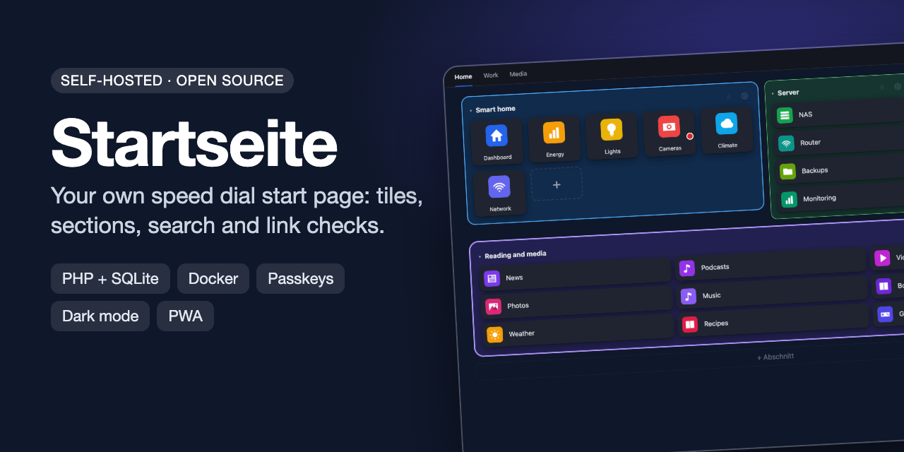
</p>

[](https://github.com/sphings79/startseite/actions/workflows/ci.yml)
[](https://github.com/sphings79/startseite/actions/workflows/docker.yml)
[](LICENSE)


[](https://buymeacoffee.com/sphings)

**English** | [Deutsch](README.de.md)

**Startseite** (German for "start page") is a self-hosted **speed dial start page and bookmark dashboard** for your browser's
home page or new tab. Bookmarks are tiles with automatic logos or screenshots, grouped into tabs and **sections**, searchable
in a keystroke, and checked in the background for dead links. One user, one SQLite file, no framework, no Composer packages.

> The user interface is currently **German only**. This README, the setup guides and the code comments are available in English and German.

If you used the **Speed Dial 2** browser extension, you can import its export. Chrome, Edge, Firefox and Safari bookmark files import as well.

## Screenshots

| Light | Dark |
|---|---|
| 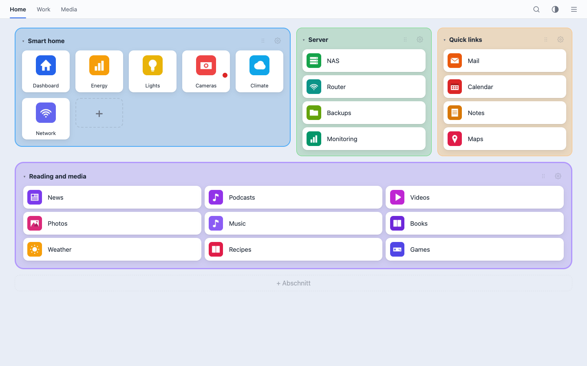 | 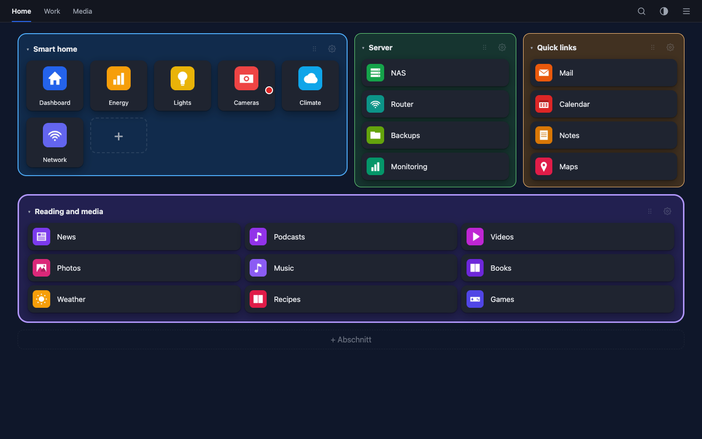 |

| Section editor | Link check |
|---|---|
| 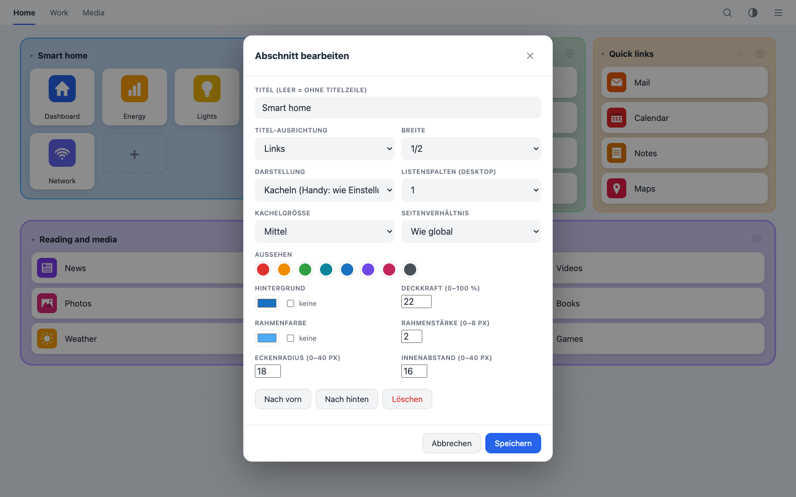 | 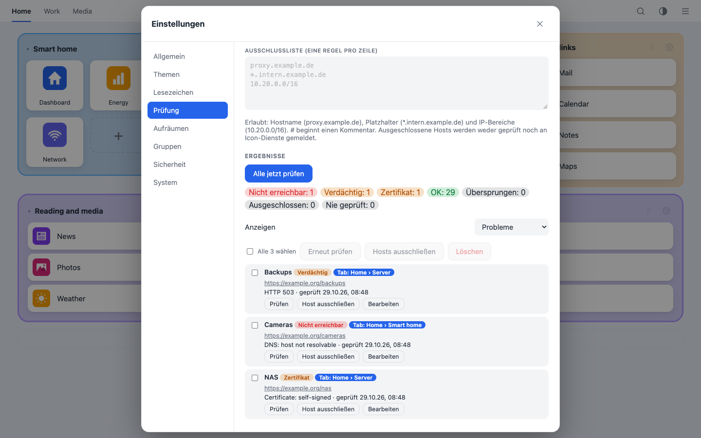 |

| Icon picker | Crop |
|---|---|
| 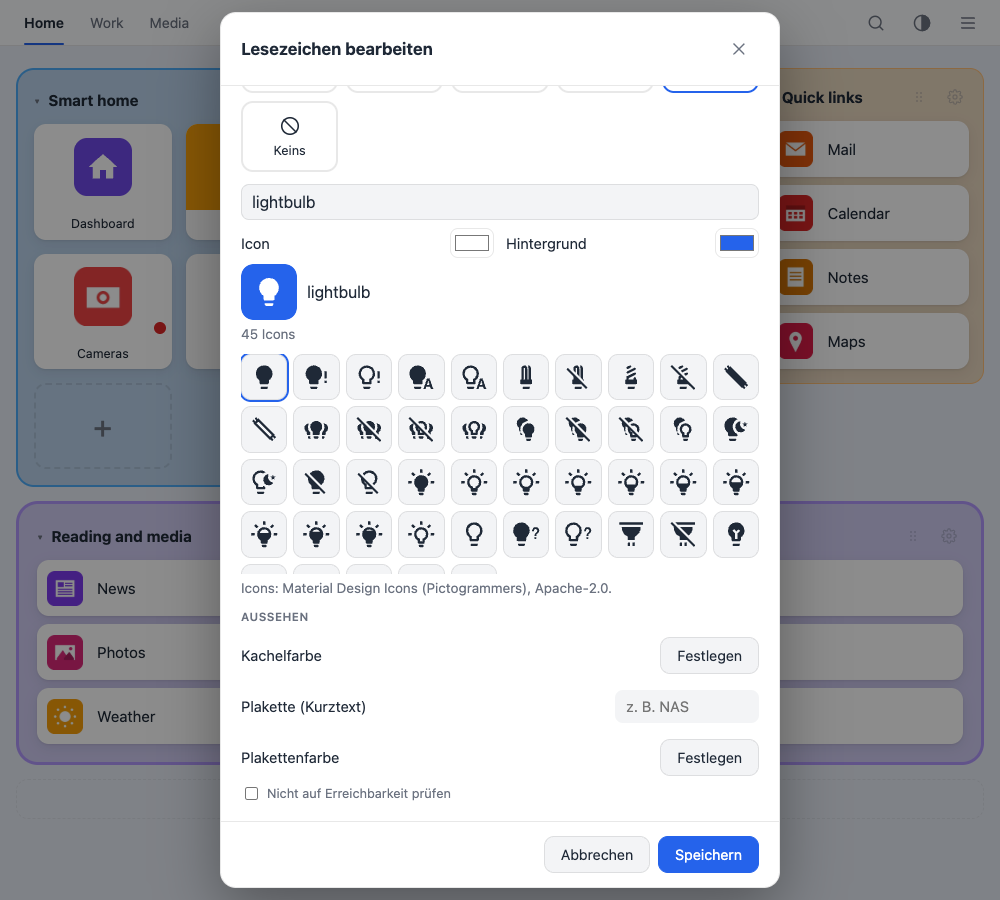 | 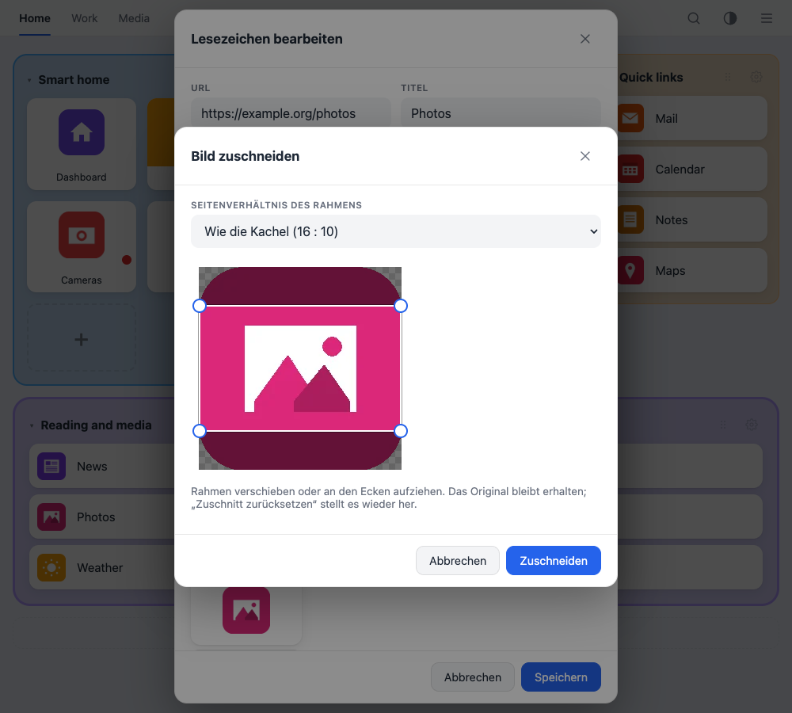 |

| Phone: sections | Phone: list | Phone: menu | Passkey login |
|---|---|---|---|
| 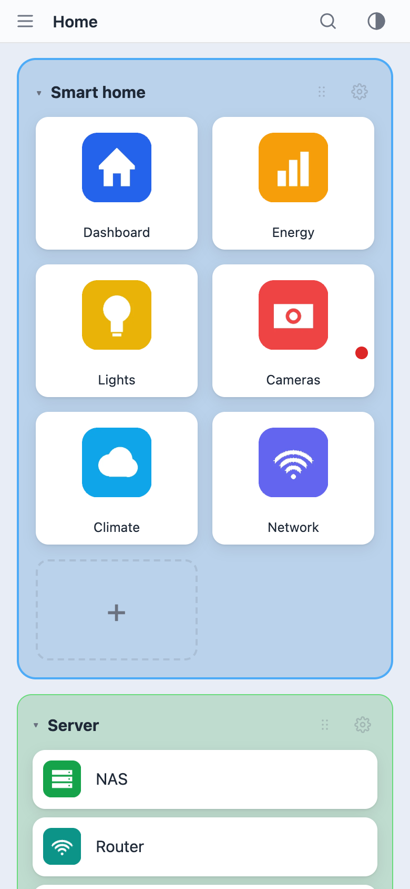 | 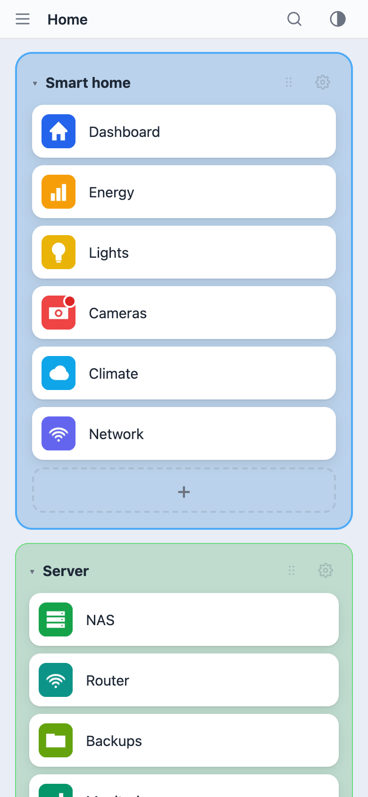 | 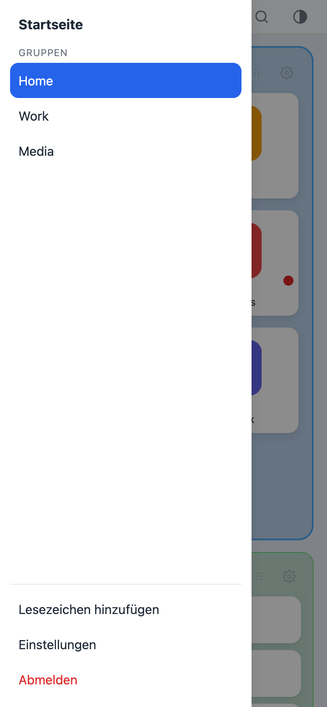 | 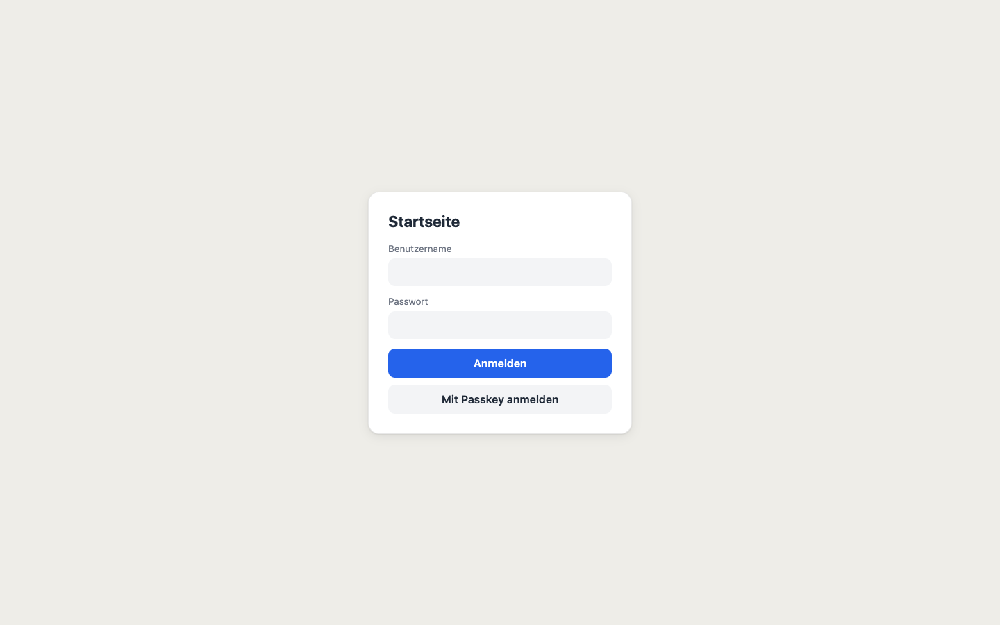 |

## Features

- **Tiles with previews:** upload, image URL (**SVG works**, drawn by Chromium), the site's own logo, [dashboard-icons](https://github.com/homarr-labs/dashboard-icons) (works for LAN services by name), a headless Chromium screenshot, or a favicon as the last resort. Logos and screenshots are always shown whole.
- **Icon picker:** search more than 7,000 [Material Design Icons](https://pictogrammers.com/library/mdi/) by name and pick glyph and background colour. The icon is stored on your server as a small SVG, nothing is loaded from outside.
- **Crop images:** cut any uploaded, downloaded or found image with a draggable frame, free or in the tile's proportions. The original is kept, so you can change the cut or undo it.
- **Tabs and sections:** every tab can hold several sections. Per section: title, width (1/4 to full, or **automatic**: it sizes itself to its content, with a maximum number of tiles per row), tiles or list (1 to 3 columns), tile size, aspect ratio, background colour with opacity, frame, corner radius, padding. Drag tiles between sections, drag sections by their grip, collapse them.
- **Fast search:** press `/`, type, hit Enter. Searches title, URL, tags, notes and the page's meta description. `#tag` filters by tag. Bang shortcuts (`g`, `ddg`, `b`, `br`, `sp`, `e`, `q`) send the query to a web search engine.
- **Link check:** a background worker finds dead links (DNS errors, refused connections, timeouts, 404/410, 5xx) and certificate problems, retries on different days before it calls a link dead, and lets you exclude hosts, groups, single bookmarks, or whole networks.
- **Clean-up suggestions:** dead, long-unvisited, duplicate and preview-less bookmarks, each with its own list, edit and delete buttons. Nothing is ever deleted automatically.
- **Import and backup:** import Speed Dial 2, a Startseite backup, or browser bookmark files (Chrome, Edge, Firefox, Safari). Automatic ZIP backups with rotation, download and restore in the UI.
- **Secure login:** Argon2id passwords, optional **TOTP** with recovery codes, and **passkeys** as a password-less login with a button on the login page (WebAuthn, user verification required). Server-side sessions, CSRF protection, strict CSP, login throttling, SSRF-safe fetching.
- **Comfortable on every device:** light, dark and automatic theme, background colour or image per theme, a list view for phones, installable as a **PWA**, quick-add bookmarklet and share target.
- **Small and boring on purpose:** PHP 8.2+, SQLite, vanilla JavaScript. No framework, no Composer packages, no build step.
- **Ready for widgets:** sections already carry a type and a config field, so widgets such as a weather card can be added later without another migration.

## Quick start with Docker

```bash
docker run -d --name startseite -p 8080:80 \
  -e STARTSEITE_ADMIN_EMAIL=you@example.org -e STARTSEITE_PASSWORD='Choose-a-long-passw0rd' \
  -v startseite-data:/data \
  ghcr.io/sphings79/startseite:latest
```

Open <http://localhost:8080> and sign in. The user is created on the first start only. Remove the password variable afterwards.
Put a reverse proxy with HTTPS in front of it for anything beyond your home network, and set `STARTSEITE_TRUSTED_PROXIES` to its address.
Passkeys need HTTPS or `localhost`.

With Docker Compose (builds the image if you do not pull it):

```bash
docker compose up -d --build
```

Edit `STARTSEITE_ADMIN_EMAIL` and `STARTSEITE_PASSWORD` (at least 12 characters with letters, a digit and a special character) in `docker-compose.yml` first. Your data lives in the `startseite-data` volume.

## Install without Docker

Requirements: PHP 8.2+ with `gd`, `pdo_sqlite`, `curl`, `mbstring`, `dom`, `zip`, and Apache with `mod_rewrite` (or nginx).

```bash
./deploy/build-package.sh            # creates dist/startseite-<version>.tar.gz and .zip
tar xzf startseite-<version>.tar.gz && cd startseite-<version>
sudo ./deploy/install.sh --app-dir /srv/startseite --web-dir /var/www/html/startseite \
     --base-path /startseite --user www-data --worker --chromium
```

Running the same command again updates the installation. `config/config.php`, your data and your login stay untouched.
Change the password with `php bin/set_password.php admin`. Release packages are also attached to each [GitHub release](../../releases).

nginx instead of `.htaccess`:

```nginx
location /startseite/ { try_files $uri /startseite/index.php?$query_string; }
```

## Configuration

`config/config.php` (template: `config/config.sample.php`) or `STARTSEITE_*` environment variables, which take precedence.

| Key | Meaning |
|---|---|
| `data_dir` | database, images, secret key; keep it outside the web root |
| `base_path` | `null` detects it from the URL; set it only if a proxy passes a prefix through |
| `trusted_proxies` | reverse proxies whose `X-Forwarded-*` headers are trusted |
| `chromium_flags` | for example `--no-sandbox` inside a container |
| `block_private_targets` | `true`: the server never fetches images or screenshots from LAN addresses (SSRF protection) |

If your bookmarks point to internal services (UniFi, Pi-hole, ...) and the server runs in the same network, set `block_private_targets` to `false`
(`STARTSEITE_BLOCK_PRIVATE=0`). A server on the internet cannot reach LAN addresses anyway; those tiles get a letter tile or an uploaded image.

## Using it

### Sections

Open a tab and use **+ Abschnitt** below the tiles, or the gear on an existing section. New tabs and existing installations start with one section without title or frame, so nothing changes until you add more.
**Settings → Lesezeichen → Abschnitte lückenlos anordnen** (off by default) packs sections into free gaps instead of row by row.
Reorder sections by the grip next to the gear or under Settings → Groups. If **Phone: list instead of tiles** is on, every section is shown as a list on phones, whatever it uses on the desktop.

### Link check

Settings → Prüfung. The worker checks every week by default (configurable or off). Rules, one per line: `proxy.example.com`, `*.internal.example.com`, `10.20.0.0/16`, `#` starts a comment.
Local addresses (private IP ranges, `localhost`, names without a dot, `.local`, `.lan`, `.internal`, `.home.arpa`, `fritz.box`) are skipped automatically. Excluded hosts are never probed and never sent to icon services.

### Quick add

Settings → Lesezeichen → Quick add: drag the button to your bookmarks bar. A click on any page opens a small window with URL and title filled in. The same page is the share target of the installed PWA on Android.
Pasting a URL with Ctrl+V or dropping a link onto the page works as well.

### Icons and cropping

Edit a bookmark and choose **Icon** as the preview. Type a name (`home`, `camera`, `server`, ...), click an icon, pick the colours. Under any other preview type, **Zuschneiden** opens the crop frame.
The uncropped original stays on the server but is not part of backups: after a restore, the cut image is what you get, without the option to change the cut.

### Backups and import

The worker writes ZIP backups to `DATA_DIR/backups/` at the interval you choose. Restore through Settings → System → Import. On the command line: `php bin/import.php export.json [--merge]`.

### Several users

Everybody signs in with an **e-mail address**. The first account is the **admin**. Every user has an entirely separate start page (tabs, bookmarks, images, settings, backups); the admin sees and manages accounts, never anybody's bookmarks.

- **Registration:** Settings → Benutzer (admins only). Choose *nobody*, *only approved addresses and domains* (one domain such as `example.org` or one address per line) or *anybody*. Every new account has to confirm its address through a link in a mail.
- **Forgot password:** "Passwort vergessen?" on the sign-in page sends a one-hour, single-use link. The answer looks the same for unknown addresses. A reset ends all sessions of that user.
- **Admin tools:** invite people (they choose their password via a link), send a reset mail, remove a lost second factor, lock, make admin, delete a user with all data, make a backup of one user and **restore a backup for one user only**.
- **Mail (SMTP):** host, port, encryption (none, STARTTLS or SSL/TLS), optional login, sender and a test button. An internal relay without login and encryption works, so do external servers with TLS and a password. The password is stored encrypted. Mails go out in German or English (the user's choice).
- **Passwords** need at least 12 characters with letters, a digit and a special character.
- **No mail yet or locked out?** Everything is possible on the command line as well:

```bash
php bin/admin.php list
php bin/admin.php create you@example.org --role=admin
php bin/admin.php password you@example.org
php bin/admin.php registration domains example.org example.net
php bin/admin.php url https://start.example.org       # base URL for links in mails
# Docker: docker compose exec -u www-data startseite php /app/bin/admin.php list
```

**Upgrading from a single-user version:** your account and all data stay and become the admin's. Give it an address once with `php bin/admin.php claim you@example.org` (the password stays), then sign in with that address. `STARTSEITE_USER` is replaced by `STARTSEITE_ADMIN_EMAIL`.

### Securing the login (optional)

Settings → Sicherheit. Without extras, the password is enough, which is fine on a home network.

- **Authenticator app (TOTP):** a 6-digit code after the password, plus 10 one-time recovery codes you can print.
- **Passkeys:** a separate sign-in path without user name and password (button on the login page). Fingerprint, face or PIN are mandatory. Needs HTTPS or `localhost`.

Changes ask for your password again and end all other sessions. If you lose your authenticator and your recovery codes:

```bash
php bin/set_password.php --reset-2fa
# Docker:
docker compose exec -u www-data startseite php /app/bin/set_password.php --reset-2fa
```

## Security notes

- Argon2id, server-side sessions (random selector and validator, only the validator's SHA-256 is stored), `HttpOnly` and `SameSite=Lax` cookies, `Secure` over HTTPS.
- CSRF token on every write, origin check, strict Content-Security-Policy, login throttling per IP and globally.
- Server-side fetches (logos, image URLs, screenshots, link checks) resolve every hop and pin the IP.
- Icon sources outside your server (dashboard-icons via GitHub/jsDelivr, Google's favicon service as the very last resort) only see an icon name or a public domain, never local or excluded hosts.
- Report vulnerabilities privately, see [SECURITY.md](SECURITY.md).

## Development and tests

No dependencies are needed to run the tests:

```bash
php tests/run.php
```

It runs unit tests (WebAuthn, link rules, sections, backup round trip) and an HTTP integration test against PHP's built-in server (login, CSRF, API, sections, passkey login with a software authenticator).
GitHub Actions run the tests on PHP 8.2, 8.3 and 8.4, build the Docker image, smoke-test it and publish it to the GitHub Container Registry.

## FAQ

**Is there a hosted version?** No. You run it yourself.
**Can I use it as my browser's home page or new tab page?** Yes. Set the browser's home page to your Startseite URL. A new-tab extension that opens a URL does the same.
**Does it phone home?** No. The only outside requests are the ones you trigger: fetching a bookmark's logo or page, link checks, and the icon sources listed above.
**Is there more than one user?** Yes. Every user has their own tabs, bookmarks, settings and backups, the admin manages the accounts (see "Several users").
**Other languages?** The interface is German for now.

## Support the project

If Startseite saves you time, a **star on GitHub** helps others find it, and you can
[buy me a coffee](https://buymeacoffee.com/sphings) if you want to say thanks.

[](https://buymeacoffee.com/sphings)

Bug reports and ideas are welcome as [issues](../../issues).

## License

[GNU AGPL-3.0](LICENSE). If you run a modified version for others over a network, you must offer them its source code. Third-party: the icon set `public/assets/vendor/mdi.json` comes from [@mdi/svg](https://github.com/Templarian/MaterialDesign-SVG) (Pictogrammers, Apache-2.0, compatible with the AGPL, see `public/assets/vendor/mdi-LICENSE.txt`). Code: `public/assets/vendor/qrcode.js` ([qrcode-generator](https://github.com/kazuhikoarase/qrcode-generator), MIT) draws the QR code for the authenticator app in your browser.

---

<sub>Keywords: speed dial, start page, startpage, new tab page, browser home page, bookmark manager, bookmark dashboard, self-hosted, homelab, link checker, dead link checker, passkeys, WebAuthn, TOTP, PHP, SQLite, Docker, PWA, Speed Dial 2 import.</sub>
